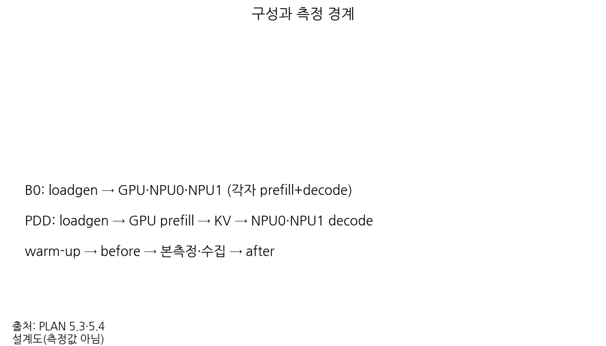
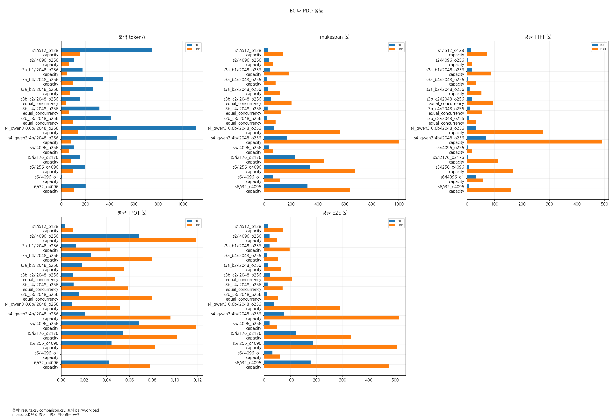
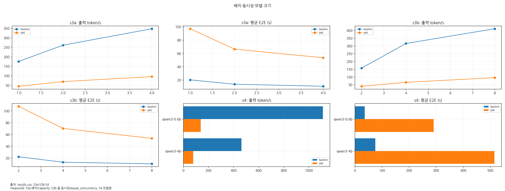
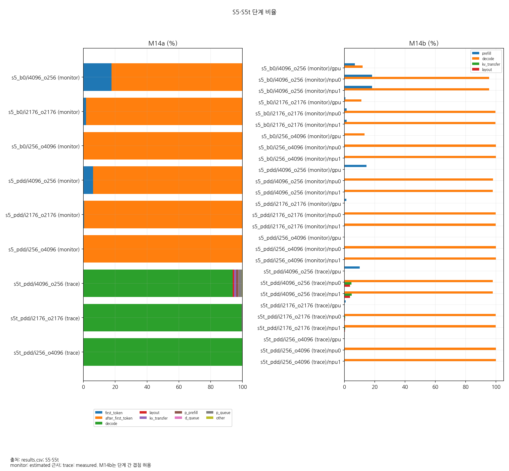
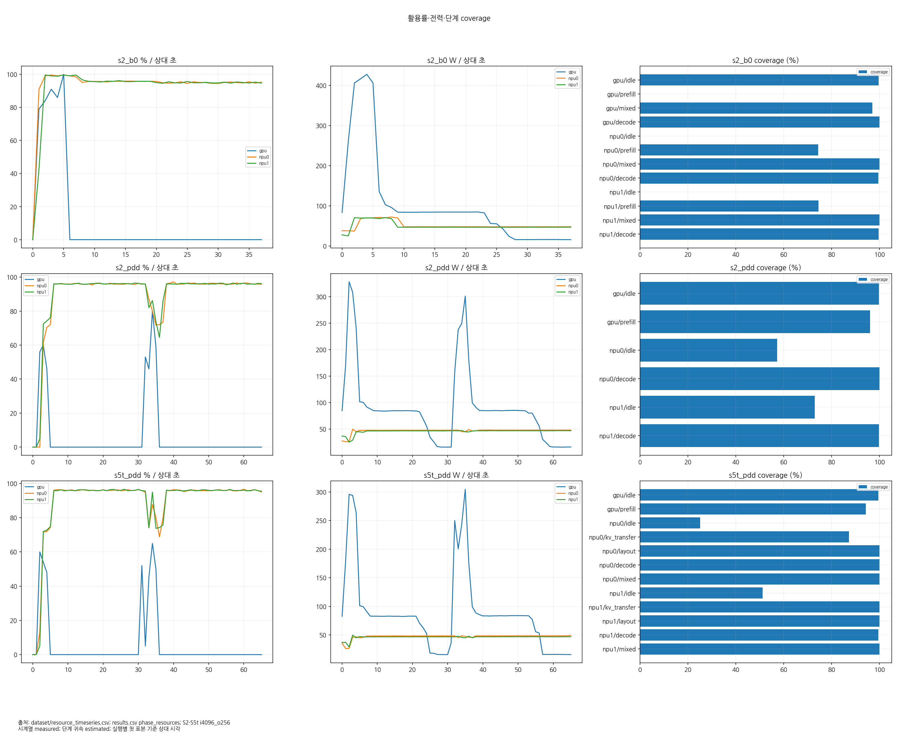
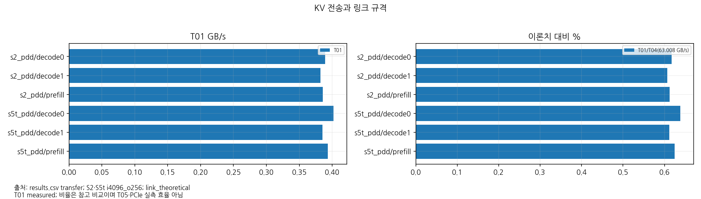
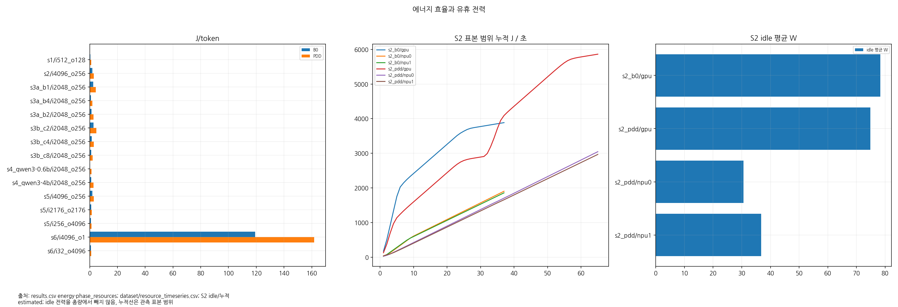
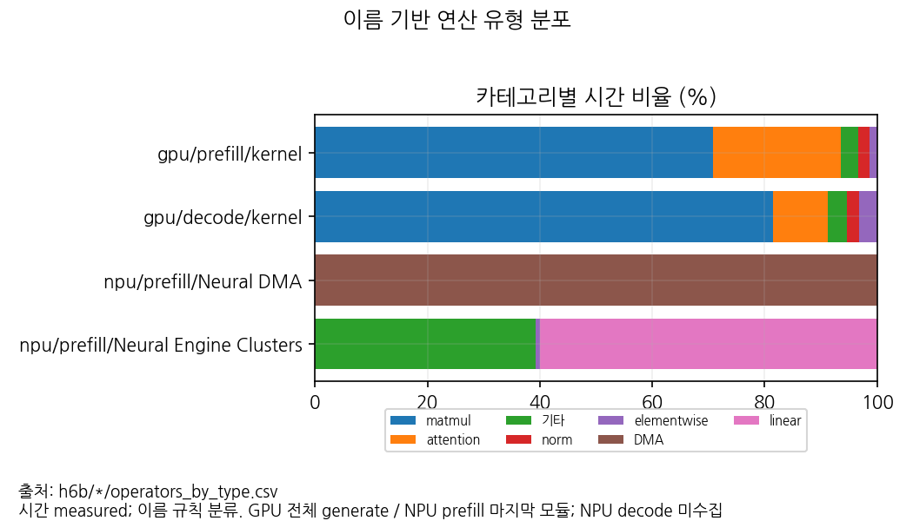
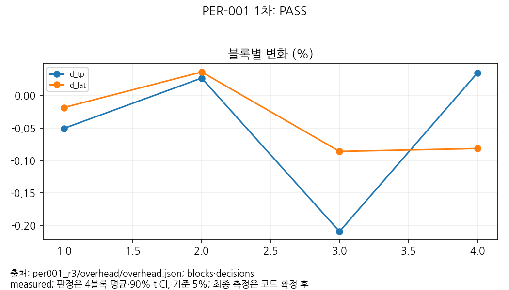

# 최종보고서 분석 장 초안

작성 기준일: 2026-11-10. 원자료를 읽어 작성했으며 원본 trace는 보존했다. H6b 집계·진단과 데이터셋을 갱신했다.
본 장은 성능 분석과 자원 관측의 결과이며, 서비스 정합성 인증이나 제품 간 일반적인 우열 판정은 아니다.

**주요 관찰:** sweep2의 유효 비교 15쌍에서 PDD의 출력 처리량은 B0보다 42.62~87.59% 낮았다.
가속기 합계 에너지/출력 토큰도 PDD가 33.85~309.18% 높았다(추정).
비교 유형·측정 시간·출력 정합성의 제한을 아래에 함께 기록한다.
출처: `sweep2/comparison.csv`, `dataset/energy.csv`, 본 장 R01~R33의 대응 쌍.

## 1. 시험 환경과 방법

### 자료와 출처 표기

`<결과 루트>`는 제공된 실측 자료 디렉터리, `<9월 패키지>`는 `pdd_gpu1_npu2_20260924` 실험 패키지를 뜻한다.
이하 `sweep2/`, `h6b/`, `per001_r3/` 등의 경로는 `<결과 루트>` 기준이다.
R01~R36은 부록의 정확한 시나리오·workload·summary 경로를 가리킨다.
각 R의 서비스 설정은 같은 run의 `service/config.json`, 클라이언트 설정은 같은 workload의 `loadgen_run.json`이다.
숫자표는 먼저 작성한 로컬 메모 `.notes/results_summary_2026-11-10.md`에 근거한다.
표의 반올림은 표시용이며 변화율은 반올림 전 원값으로 계산했다.

`sweep2/results.csv`의 36행 모두 `run_status=PASS`, `analysis_status=PASS`다.
`comparison.csv`의 15행 변화율을 재계산했으며, results의 주요 수치·중첩 지표를 원본 summary와 대조했다.
`dataset/`의 runs 36행, requests 2,768행, phase_resources 1,671행, resource_timeseries 81,389행,
transfer·memory_bw 각 108행, energy 144행을 확인했다. 이는 독립 반복 실험 수가 아니다.
`runs/..._1` 등의 이름도 반복 측정 통계로 합치지 않고 results가 선택한 실행만 사용했다.
출처: `sweep2/{results.csv,comparison.csv,dataset/*.csv}`.

### 장비·소프트웨어

| 항목 | 확인 내용 | 근거·범위 |
| --- | --- | --- |
| GPU | NVIDIA RTX PRO 6000 Blackwell Workstation Edition 1장, 96GB GDDR7 | `.notes/PLAN.md` 1장; 장치명·식별은 S1_S2 메모 H2 및 각 run의 links.json |
| NPU | RBLN-CA22 2장, 장치당 16GB GDDR6 | 같은 자료; 보드 메모리와 시스템 RAM은 구분 |
| 링크 | GPU 최대 Gen5 ×16, NPU 32.0GT/s ×16; 계획상 NUMA 노드 0 | `.notes/S1_S2_repro_2026-11-06.md` H3; 최대 규격이며 부하 중 유효 대역폭 아님. NUMA는 PLAN 설정 |
| 추론·컴파일러 | CUDA vLLM 0.22.0, RBLN vLLM 0.22.0+cpu, compiler 0.11.1.post2.dev2+g2995098f.prod | sweep2의 선택된 모든 service/config.json `environment` |
| 코드 | `07074fdb1bb97e5bbf771a2cefad1ed0da7ae96d` | 같은 environment.commit; 서비스 기동은 2026-11-10(KST) 자료 |
| 도구 고정값 | all-smi 0.28.1, otelcol-contrib 0.163.2, Perfetto·Python 패키지 58.2/0.58.2, matplotlib 3.10.9 | `tools/hetero/third_party/versions.env`; 고정 명세이며 이번 보고 작성에서 실행 바이너리 버전을 다시 조회하지 않음 |

### 구성·부하 조건

B0는 GPU·NPU 각각이 prefill과 decode를 수행하는 전체 추론 서버 구성이다.
PDD는 GPU prefill 서버와 NPU decoder 두 서버를 사용하는 역할 분리 구성이다.
`capacity`는 B0 장치별 슬롯을 배치 수만큼, PDD 동시성을 배치 수의 두 배로 둔다.
따라서 배치 4의 B0 총 슬롯 12와 PDD 동시성 8은 같지 않다.
`equal_concurrency`인 S3b에서만 합계 동시성을 맞춘다.
동시성 2/4/8의 B0 슬롯 배분은 GPU·NPU0·NPU1 순으로 (1,1,0)/(2,1,1)/(3,3,2)다.
동시성 2에서는 NPU1에 요청이 없으므로 세 장치 모두가 추론에 참여한 비교가 아니다.
출처: R03~R04, R11~R16의 loadgen_run.json `slots`; `.notes/PLAN.md` 9장.

| 시나리오 | 모델 / dtype | 입력·출력 토큰 | 요청 수 | 배치 / blocks | 비교·모드 | 출처 |
| --- | --- | --- | --- | --- | --- | --- |
| S1 | Qwen3-0.6B / FP16 | 512/128 | 176 | 1 / 32, ctx 1024 | capacity·monitor | R01~R02 |
| S2 | Qwen2.5-3B-Instruct / BF16 | 4096/256 | 16 | 4 / 160, ctx 4352 | capacity·monitor | R03~R04 |
| S3a | Qwen2.5-3B / BF16 | 2048/256 | 32 | 1/2/4, blocks 40/80/160 | capacity·monitor | R05~R10 |
| S3b | Qwen2.5-3B / BF16 | 2048/256 | 32 | 4 / 160; 동시성 2/4/8 | equal_concurrency·monitor | R11~R16 |
| S4 | Qwen3-0.6B·4B / FP16 | 2048/256 | 304 | 4 / 160 | capacity·monitor | R17~R20 |
| S5 / S5t | Qwen2.5-3B / BF16 | 4096/256, 2176/2176, 256/4096 | 각 16 | 4 / 160 | S5 양 구성 monitor; S5t PDD trace | R21~R29 |
| S6 | Qwen2.5-3B / BF16 | 4096/1, 32/4096 | 각각 280, 16 | 4 / 160 | capacity·monitor | R30~R33 |
| S7 / S8 | Qwen2.5-3B / BF16 | 4096/256 | 각 16 | 4 / 160 | PDD trace; reorder 비교 / 부하 참고 | R34~R36 |

S1 외 서비스 최대 길이는 4352이고, 위 서비스의 block_size와 max_num_batched_tokens는 각각 128이다.
seed는 20260924이며, 실제 입력·출력 토큰 수와 성공 수는 원자료 검증 대상이다.
출처: R01~R36 service/config.json·loadgen_run.json; results.csv.

### 측정 구간과 모드

warm-up은 본측정에서 분리한다. makespan은 첫 예정 도착부터 마지막 완료까지,
출력 처리량은 성공 출력 토큰 합/makespan이다.
TTFT·E2E는 예정 도착 기준이어서 클라이언트 큐 대기를 포함한다.
TPOT는 `(마지막 출력−첫 출력)/(출력 토큰 수−1)`의 요청별 평균이다.
백분위는 기존 loadgen의 nearest-rank 정의를 따른다.
출처: `tools/hetero/profiler/analysis.py`, `docs/hetero/metrics_definition.md`.

monitor는 서버 경계 차분과 all-smi 시계열을 사용하고, trace는 OTEL span과 RBLN 이벤트를 추가한다.
본측정 자원·에너지는 서버 기동·컴파일·warm-up을 포함하지 않는다.
REALTIME span과 MONOTONIC 클라이언트·엔진 기록은 clock anchor로 맞춘다.
서버 ID는 `cmpl-<client_id>-0`, 엔진 ID는 그 뒤의 16진수 8자리 접미사를 제거해 매칭한다.
출처: `.notes/H0_2026-11-06.md`, `profiler/{expected,common,resources}.py`(tools/hetero 기준).

자원 비교의 목표는 본측정 30초 이상, S6는 120초 이상이었다.
그러나 S3a b4 B0 23.551초, S3b c4/c8 B0 25.940/19.944초,
S6 prefill B0/PDD 66.638/116.353초는 목표 미달이다(R07, R13, R15, R30, R32).
수집 검증 PASS는 성공 샘플·경계·매칭 조건을 뜻하며 이 시간 목표까지 보장하지 않는다.
추정 요청 수를 사용한 `.notes/WP11_2026-11-09.md`와 S6 pilot 이후에도 실제 소요 시간 재점검이 필요하다.

오프라인 H6b는 Qwen2.5-3B-Instruct로 GPU·NPU 각각 prefill 4096/1, decode 32/256,
각 4요청을 실행했다. `h6b/{gpu_prefill,gpu_decode,npu_prefill,npu_decode}/meta.json` 모두 PASS이며,
GPU json.gz와 NPU .pb 생성을 확인했다. 연산자 집계·무결성 판정은 8장에 기술하며 온라인 처리량과 합산하지 않는다.
NPU decode는 추가로 32/64 × 4요청을 재측정했다(`h6b/npu_decode_short/meta.json`, PASS).
256·64토큰 모두 trace 무결성 문제가 있어 NPU decode 연산자는 미수집이다.
출처: 각 meta.json 및 같은 폴더의 trace 파일; `.notes/H6b_2026-11-10.md`.

그림 1. 출처: PLAN 5.3·5.4. 설계도(측정값 아님).

## 2. B0 대 PDD 지연·처리량

### 조건별 처리량과 완료 시간

처리량 변화=`(PDD/B0−1)×100`, makespan 감소=`(1−PDD/B0)×100`이다.
음수 감소율은 시간이 늘었다는 뜻이며 값의 크기를 잘라내지 않았다.
표의 출처는 각 R과 `sweep2/comparison.csv`의 같은 pair_id·workload다.

| 조건 / i/o | B0 → PDD 출력 token/s | 처리량 변화(%) | makespan B0 → PDD(s) | makespan 감소(%) | 출처 |
| --- | --- | --- | --- | --- | --- |
| s1 / i512_o128 | 746.761 → 157.038 | -78.97 | 30.168 → 143.456 | -375.53 | R01, R02 |
| s2 / i4096_o256 | 108.935 → 62.502 | -42.62 | 37.600 → 65.534 | -74.29 | R03, R04 |
| s3a_b1 / i2048_o256 | 175.590 → 44.889 | -74.44 | 46.654 → 182.496 | -291.17 | R05, R06 |
| s3a_b4 / i2048_o256 | 347.834 → 95.520 | -72.54 | 23.551 → 85.762 | -264.15 | R07, R08 |
| s3a_b2 / i2048_o256 | 261.164 → 69.336 | -73.45 | 31.367 → 118.150 | -276.67 | R09, R10 |
| s3b_c2 / i2048_o256 | 157.261 → 40.286 | -74.38 | 52.092 → 203.347 | -290.36 | R11, R12 |
| s3b_c4 / i2048_o256 | 315.810 → 65.502 | -79.26 | 25.940 → 125.065 | -382.14 | R13, R14 |
| s3b_c8 / i2048_o256 | 410.741 → 95.598 | -76.73 | 19.944 → 85.692 | -329.65 | R15, R16 |
| s4_qwen3-0.6b / i2048_o256 | 1112.205 → 137.986 | -87.59 | 69.973 → 563.999 | -706.03 | R17, R18 |
| s4_qwen3-4b / i2048_o256 | 461.881 → 77.727 | -83.17 | 168.493 → 1001.248 | -494.24 | R19, R20 |
| s5 / i4096_o256 | 108.879 → 62.345 | -42.74 | 37.620 → 65.699 | -74.64 | R21, R24 |
| s5 / i2176_o2176 | 153.786 → 78.344 | -49.06 | 226.392 → 444.400 | -96.30 | R22, R25 |
| s5 / i256_o4096 | 192.659 → 97.223 | -49.54 | 340.165 → 674.076 | -98.16 | R23, R26 |
| s6 / i4096_o1 | 4.202 → 2.406 | -42.73 | 66.638 → 116.353 | -74.61 | R30, R32 |
| s6 / i32_o4096 | 203.805 → 102.696 | -49.61 | 321.562 → 638.158 | -98.46 | R31, R33 |

현재 조건에서는 PDD 처리량 우세를 관측하지 못했다. S3b에서도 같은 방향이므로 capacity의
슬롯 차이만으로 전체 차이를 설명할 수는 없다. 반면 모델·부하·서버 역할이 제한된 단일 실험이므로
모든 PDD 구성의 일반적 성능이나 최적 구성의 한계를 뜻하지 않는다.

### 지연

아래 값은 요청별 지연의 평균 및 E2E p95다. TPOT는 표의 초 단위 반올림 때문에 작은 차이가 생략될 수 있다.
출력 1토큰인 S6 prefill의 TPOT는 0이 아니라 not_collected다.

| 조건 / i/o | TTFT 평균 B0 → PDD(s) | TPOT 평균 B0 → PDD(s) | E2E 평균 B0 → PDD(s) | E2E p95 B0 → PDD(s) | 출처 |
| --- | --- | --- | --- | --- | --- |
| s1 / i512_o128 | 14.734 → 71.541 | 0.004 → 0.011 | 15.202 → 72.896 | 28.763 → 137.029 | R01, R02 |
| s2 / i4096_o256 | 3.125 → 18.446 | 0.069 → 0.119 | 20.645 → 48.675 | 37.600 → 65.534 | R03, R04 |
| s3a_b1 / i2048_o256 | 17.040 → 86.027 | 0.013 → 0.043 | 20.411 → 96.904 | 35.854 → 182.109 | R05, R06 |
| s3a_b4 / i2048_o256 | 4.253 → 33.128 | 0.026 → 0.080 | 10.851 → 53.494 | 23.551 → 85.571 | R07, R08 |
| s3a_b2 / i2048_o256 | 9.196 → 52.326 | 0.018 → 0.055 | 13.889 → 66.383 | 31.367 → 117.884 | R09, R10 |
| s3b_c2 / i2048_o256 | 19.564 → 95.757 | 0.010 → 0.048 | 22.202 → 107.901 | 40.046 → 203.041 | R11, R12 |
| s3b_c4 / i2048_o256 | 10.266 → 55.423 | 0.011 → 0.058 | 13.027 → 70.314 | 25.938 → 124.877 | R13, R14 |
| s3b_c8 / i2048_o256 | 6.280 → 33.109 | 0.015 → 0.080 | 10.227 → 53.475 | 19.944 → 85.501 | R15, R16 |
| s4_qwen3-0.6b / i2048_o256 | 33.896 → 277.488 | 0.010 → 0.051 | 36.405 → 290.572 | 68.754 → 541.518 | R17, R18 |
| s4_qwen3-4b / i2048_o256 | 69.597 → 490.325 | 0.021 → 0.096 | 74.968 → 514.795 | 140.200 → 958.087 | R19, R20 |
| s5 / i4096_o256 | 3.101 → 18.526 | 0.069 → 0.119 | 20.623 → 48.761 | 37.620 → 65.699 | R21, R24 |
| s5 / i2176_o2176 | 4.396 → 112.194 | 0.054 → 0.101 | 122.676 → 332.781 | 226.392 → 444.400 | R22, R25 |
| s5 / i256_o4096 | 5.780 → 168.749 | 0.044 → 0.082 | 186.863 → 505.351 | 340.165 → 674.076 | R23, R26 |
| s6 / i4096_o1 | 32.210 → 59.071 | 미수집(출력 1토큰) | 32.210 → 59.072 | 60.791 → 110.497 | R30, R32 |
| s6 / i32_o4096 | 5.668 → 159.537 | 0.042 → 0.078 | 177.500 → 478.270 | 321.562 → 638.158 | R31, R33 |

S1 PDD의 평균 TTFT 71.541초 중 클라이언트 큐 대기 평균은 71.267초이며,
send 기준 service TTFT는 0.274초다(R02).
S5 PDD 256/4096도 TTFT 168.749초, 큐 168.453초, service TTFT 0.296초다(R26).
따라서 예정 도착 기준 TTFT 증가를 전부 GPU prefill 연산 지연으로 해석하면 안 된다.
유한 요청 집합·제한된 슬롯에서 발생한 큐잉 결과이며 도착률을 고정한 SLA 시험과도 다르다.

### 9월 기준과의 관계

| 조건 | 9월 출력 token/s | sweep2 출력 token/s | 변화(%) | 비교 제한·출처 |
| --- | ---: | ---: | ---: | --- |
| S1 B0 | 543.519 | 746.761 | +37.39 | 요청 18→176으로 달라 직접 재현 판정 불가; SEP1-B, R01 |
| S1 PDD | 154.745 | 157.038 | +1.48 | 같은 요청 수 차이; SEP1-P, R02 |
| S2 B0 | 109.318 | 108.935 | -0.35 | 입력·출력·요청 수 대응; SEP2-B, R03 |
| S2 PDD | 62.245 | 62.502 | +0.41 | 입력·출력·요청 수 대응; SEP2-P, R04 |

9월과 같은 소규모 부하로 수행한 별도 재현은 `.notes/S1_S2_repro_2026-11-06.md`에 기록돼 있다.
S1 sweep2의 처리량 증가는 요청 수·종료 시점의 장치별 잔여 작업 영향일 가능성이 있다(**추정**).
현재 B0 요청 배분은 GPU/NPU0/NPU1=132/22/22다(R01). 이를 코드 개선 효과로 단정하지 않는다.

그림 2. 출처: results.csv·comparison.csv; 표의 pair/workload. measured; 단일 측정, TPOT 미정의는 공란.

## 3. 모델 크기·배치·동시성 변화의 영향

**배치(S3a).** 배치 1→2→4에서 B0 처리량은 175.590→261.164→347.834,
PDD는 44.889→69.336→95.520 token/s로 증가했다(R05~R10).
동시에 TPOT 평균은 B0 0.013→0.018→0.026초, PDD 0.043→0.055→0.080초로 증가했다.
처리량 개선과 요청당 토큰 지연의 교환관계가 관측되지만, 배치와 슬롯·동시성·블록 수가 함께 바뀐
시험이므로 순수한 배치 연산 효율만 분리한 결과는 아니다.

**동시성(S3b).** 동시성 2→4→8에서 B0 처리량 157.261→315.810→410.741,
PDD 40.286→65.502→95.598 token/s가 관측됐다(R11~R16).
서버 배치는 고정했으나 B0 장치별 슬롯 배분도 변한다. 추가 부하가 처리량을 높였다는 관찰과,
어떤 장치의 스케줄러·커널 효율이 원인이라는 해석을 구분한다.

**모델(S4).** 동일 2048/256 부하에서 0.6B→4B 변경 시 B0는 1112.205→461.881,
PDD는 137.986→77.727 token/s였다(R17~R20).
B0에서 GPU가 처리한 요청은 각각 264/304, 260/304개다(같은 R의 device_request_counts).
작은 모델에서 B0의 GPU가 많은 요청을 처리한 사실은 역할 분리와 기회비용을 비교할 단서다.
다만 GPU decode를 PDD에 추가했을 때의 개선량은 직접 측정하지 않았다(**추정 과제**).

배치 8은 B0 NPU 전체 추론 서버의 샘플러 초기화 실패로 제외했다.
vLLM의 `HAS_TRITON and logits.shape[0] >= 8` 경로가 RBLN에 미구현인 `num_compute_units`를 호출했다.
PDD decode 전용 배치 8은 성공했지만 B0 쌍이 없어 비교하지 않는다.
근거: `.notes/S3a_batch2_2026-11-10.md`, `sweep1/runs/s3a_b8_b0/service/logs/npu0.log:300`,
`sweep1/runs/s3a_b8_pdd/i2048_o256/profile/summary.json`.
현재 배치 2 실행의 성공은 R09~R10으로 확인된다.

그림 3. 출처: results.csv; S3a·S3b·S4. measured; S3a 배치/capacity, S3b 총 동시성/equal_concurrency, S4 모델명.

## 4. 분할 비율 대체 분석: S5와 S5t

D2는 입출력 길이비로 조건을 바꿔 관찰한다는 합의다. 입력+출력=4352를 유지한
4096/256, 2176/2176, 256/4096의 길이비는 모델 레이어 분할률이나 장치 계산량 배분률이 아니다.
M14는 그 조건에서 관측된 결과이며 분할 비율 자체를 대체하는 숫자가 아니다.
출처: `.notes/PLAN.md` D2·9장, R21~R29.

### M14a: 요청 서비스 구간의 배타적 구성비

trace에서는 [send, completed] 안의 구간을 잘라 decode > layout > KV > prefill > 서버 큐 순으로
중복 없이 귀속한다. 나머지가 기타다. 요청별 비율을 평균하며 클라이언트 대기는 분모에 넣지 않는다.
원래 단계 경과시간 M06~M10은 겹침을 허용한 별도 값으로 유지한다.
H0의 음수 기타 문제는 이 정의로 수정했으므로 과거 수정 전 수치를 쓰지 않는다.
출처: `.notes/M14a_KV_transport_2026-11-07.md`, `resources.py`, 각 summary의 definition.

아래는 S5t trace의 평균 비율(%); 반올림 전 합은 100%다(R27~R29).

| S5t i/o | P 큐 | P prefill | KV | layout | D 큐 | decode | 기타 | 출처 |
| --- | --- | --- | --- | --- | --- | --- | --- | --- |
| i4096_o256 | 2.122 | 1.310 | 1.193 | 0.929 | 0.160 | 93.871 | 0.416 | R27 |
| i2176_o2176 | 0.172 | 0.106 | 0.094 | 0.081 | 0.016 | 99.483 | 0.048 | R28 |
| i256_o4096 | 0.011 | 0.010 | 0.018 | 0.015 | 0.010 | 99.914 | 0.023 | R29 |

### M14b: 장치별 단계 활성 구간 비율

각 단계 구간의 합집합 길이를 본측정 구간으로 나눈다. layout은 H2D+reorder를 합친 호스트 관측 구간이다.
단계끼리는 겹칠 수 있으므로 M14b의 여러 단계 합이 100%일 필요는 없다.
장치 busy 비율 R09b나 all-smi utilization과도 다른 값이다. 아래 단위는 %다.

| S5t i/o | GPU prefill | NPU0 KV / layout / decode | NPU1 KV / layout / decode | 출처 |
| --- | --- | --- | --- | --- |
| i4096_o256 | 10.097 | 4.576 / 3.694 / 97.893 | 4.776 / 3.593 / 97.883 | R27 |
| i2176_o2176 | 0.820 | 0.369 / 0.326 / 99.803 | 0.379 / 0.319 / 99.820 | R28 |
| i256_o4096 | 0.061 | 0.061 / 0.063 / 99.953 | 0.069 / 0.057 / 99.976 | R29 |

S5 monitor의 M14a는 first_token/after_first_token 근사 구분이며, M14b도 클라이언트 구간 귀속에 기반한 **추정**이다.
S5t의 세부 서버 단계와 같은 정확도로 합치지 않는다(R21~R29의 status/source).
출력이 긴 조건에서 decode 비중은 커지고 GPU prefill 활성 구간은 작아졌다.
이는 NPU decode 경로가 관측 서비스 시간을 지배한다는 근거지만 NPU가 연산 포화인지 메모리 병목인지는 확정하지 않는다.

그림 4. 출처: results.csv; S5·S5t. monitor: estimated 근사; trace: measured. M14b는 단계 간 겹침 허용.

## 5. 단계별 자원 활용률

자원 표는 all-smi 표본의 시간가중 귀속 **추정**이다. GPU는 UUID, NPU는 PCI bus ID를 links.json과
대응시키며 gpu_index만으로 장치를 정하지 않는다.
장치 상태에는 해당 장치 센서를, 시스템 합성 상태에는 CPU·호스트 메모리를 귀속한다.
출처: `.notes/S1_S2_repro_2026-11-06.md` H2, `resources.py`, `dataset/{phase_resources,resource_timeseries}.csv`.

S2 본측정 전체 평균은 다음과 같다. 메모리 GiB는 bytes/2^30으로 환산했다.

| 시나리오 / 상태 | GPU 활용률(%) / 전력(W) | NPU0 활용률(%) / 전력(W) | NPU1 활용률(%) / 전력(W) | 시스템 CPU(%) / 메모리(GiB) | 출처 |
| --- | --- | --- | --- | --- | --- |
| s2_b0 / all | 11.89 / 105.92 | 93.23 / 51.32 | 92.00 / 49.95 | 5.04 / 24.24 | R03 |
| s2_pdd / all | 6.16 / 90.72 | 88.85 / 46.71 | 89.35 / 45.58 | 10.82 / 25.73 | R04 |

S2 장치 메모리 평균은 B0/PDD 모두 GPU 약 7.41GiB, NPU 각각 약 6.82GiB다(R03~R04).
이는 사용량 센서이며 GPU GDDR7·NPU GDDR6·시스템 RAM을 같은 메모리 공간으로 합치지 않는다.

| 조건·장치·상태 | 활용률 평균(%) | 전력 평균(W) | 상태 coverage(%) | 근거 |
| --- | ---: | ---: | ---: | --- |
| S2 B0 GPU decode | 81.67 | 350.05 | 100.00 | R03 |
| S2 B0 NPU0 / NPU1 decode | 95.48 / 95.58 | 50.61 / 48.64 | 99.52 / 99.53 | R03 |
| S2 PDD GPU prefill(클라이언트 근사) | 37.07 | 194.67 | 96.06 | R04 |
| S2 PDD NPU0 / NPU1 decode(클라이언트 근사) | 89.67 / 90.69 | 46.89 / 45.71 | 100.00 / 99.73 | R04 |
| S5t 4096/256 GPU prefill | 28.10 | 183.55 | 94.28 | R27 |
| S5t 4096/256 NPU0 / NPU1 decode | 92.68 / 93.12 | 47.96 / 46.73 | 100.00 / 99.52 | R27 |

모든 위 자원 평균은 추정이다. 시스템 S2 PDD의 prefill/mixed/decode CPU 평균은
8.58/12.95/10.54%, coverage는 63.05/100.00/99.69%다(R04).
전체 CPU 평균이 B0보다 높다는 관찰만으로 프록시·전송 등 특정 프로세스의 CPU 비용을 분리할 수 없다.

짧은 구간은 특히 조심해야 한다. S5t 256/4096 GPU prefill utilization은 저장값 0%지만
coverage가 53.26%이며, 시스템 prefill CPU는 coverage=0으로 not_collected다(R29).
S5t 4096/256 시스템 prefill CPU coverage도 0.009631%에 불과하다(R27).
이 값을 “연산이 없었다” 또는 신뢰할 수 있는 단계 평균으로 해석하지 않는다.
전체 수집 PASS가 모든 세부 상태 구간의 충분한 표본을 보장하지 않는 사례다.

그림 5. 출처: dataset/resource_timeseries.csv; results.csv phase_resources; S2·S5t i4096_o256. 시계열 measured; 단계 귀속 estimated; 실행별 첫 표본 기준 상대 시각.

## 6. 데이터 전송 효율과 병목

### PCIe·KV 전송·NPU 적재

T01은 NIXL 경계 차분 `Δbytes/Δxfer_seconds/10^9`이다. 링크 payload만의 전송률이 아니라
해당 계측이 포함한 경과시간 기준 처리율이다.
T04=63.008GB/s는 수집한 링크 규격을 환산한 이론값이며 실측 대역폭이 아니다(R04, R27~R29).
S2 PDD의 decoder별 T01은 0.389/0.382GB/s이고, GPU 측 T05는 0.612%의 **추정**이다(R04).
T05의 낮은 값만으로 PCIe 링크 포화를 주장할 수 없다. NPU 측 T05와 T03은 copy_ 동기 여부 미확인(H4)으로 미수집이다.

아래 M08은 엔진 start~done의 요청별 평균, M09a는 host copy_ 호출 시간 합의 요청별 평균이다.
둘은 별개 구간이므로 직접 더해 전체 임계 경로로 만들지 않는다.
M09b는 reorder 시간 합이다. S5t의 reorder=0 조건에서 값이 0인 것은 해당 분기를 사용하지 않은 결과다.
T01은 경계 차분, 나머지는 요청 이벤트·step에서 가져왔다.

| S5t i/o / decoder | T01(GB/s) | M08 이벤트 평균(s) | M09a host copy 평균(s) | M09b reorder 평균(s) | T06(GB/s, 하한 추정) | T07(%, 하한 추정) | 출처 |
| --- | --- | --- | --- | --- | --- | --- | --- |
| i4096_o256 / decode0 | 0.402 | 0.375748 | 0.294102 | 0.000000 | 58.555 | 22.873 | R27 |
| i4096_o256 / decode1 | 0.385 | 0.392120 | 0.286696 | 0.000000 | 58.650 | 22.910 | R27 |
| i2176_o2176 / decode0 | 0.391 | 0.205220 | 0.176314 | 0.000000 | 66.451 | 25.957 | R28 |
| i2176_o2176 / decode1 | 0.380 | 0.211130 | 0.172664 | 0.000000 | 66.429 | 25.949 | R28 |
| i256_o4096 / decode0 | 0.182 | 0.052133 | 0.052516 | 0.000000 | 80.482 | 31.438 | R29 |
| i256_o4096 / decode1 | 0.148 | 0.070363 | 0.047635 | 0.000000 | 80.461 | 31.430 | R29 |

S5t 4096/256 NIXL 경계 평균 전송시간은 decoder0/1 0.375545/0.391813초로
이벤트 M08 0.375748/0.392120초와 비슷하지만 같은 관측 경계는 아니다(R27).
입력이 줄 때 바이트량도 줄지만 고정 지연·동시 실행의 영향이 남을 수 있다(**추정**).
S5t 256/4096의 T01 감소를 곧바로 링크 성능 저하로 부르지 않는다(R29).

S2 PDD monitor에서 GPU 서버 평균 prefill은 0.415초, decoder별 decode는 30.340/30.122초다(R04.server).
M14a 및 이 경과시간은 긴 출력 조건의 decode 경로 우선 조사를 지지한다.
전송만 제거했을 때의 처리량 개선은 실행 중 겹침·큐잉이 있어 단순 비율로 예측하지 않는다.

T02는 `전송 count 단위 미확인(H5)`으로 미수집이다.
기존 H5에서 count와 요청 수가 맞았지만 여러 KV 그룹·재시도에서도 동일 단위인지는 확인하지 않았다.
출처: `.notes/S1_S2_repro_2026-11-06.md` H5, R04·R27~R29.transfer.

그림 6. 출처: results.csv transfer; S2·S5t i4096_o256; link_theoretical. T01 measured; 비율은 참고 비교이며 T05·PCIe 실측 효율 아님.

### GDDR6 대역폭

위 NPU T06은 모델 가중치·문맥 기반 바이트 추정량을 decode step의 호스트 관측 구간 합으로 나눈
**하한 추정**이다. T07도 같은 표기의 이론 대역폭 대비 비율이며 메모리 컨트롤러 실측 효율이 아니다.
T07 분모는 설정된 NPU_MEM_BW_GBPS=256GB/s다(PLAN 1장 이론치, R27~R29.memory_bandwidth).
장치 device 시간이 누락되어 `reason="device 시간 없음: 호스트 관측 구간 기준 하한 추정"`을 유지한다.
가중치 재사용·실제 메모리 트래픽을 측정한 값이 아니므로 추정식 전체가 물리적 대역폭 하한을 보장한다고 확대하지 않는다.
GPU T06·T07은 현재 sweep 결과에서 `WP9에서 산출`로 미수집이며 연산자 집계 후에도 step별 접근 바이트 미확인으로 미수집이다.

**copy_ 동기 여부 미확인(H4)이므로 h2d_ns는 호스트 호출 시간 기준이며, H2D 전송 대역폭으로 단정하지 않는다.**
H0와 s8의 바이트·호출 시간 규모 비교는 모델·배치가 달라 동기성 확정의 충분한 근거가 아니다.
R09b도 device 누락으로 미수집이며 all-smi 활용률이나 M14b로 대체하지 않는다.
출처: `.notes/{HW_H4_H6_H7,H6_fix}_2026-11-09.md`.

### UCX와 reorder

기존 H0·S2 로그는 UCX 백엔드 및 upstream NIXL host-bounce 경로를 명시한다.
선택된 transport/lane이 TCP·RDMA·shared memory 중 무엇인지는 로그로 확인되지 않았다(미확인 H5).
분산 초기화의 tcp 주소나 RDMA probe 경고만으로 KV transport를 확정하지 않는다.
출처: `h0_trace/service/logs/decode0.log:66,71`, `s2_pdd/service/logs/decode0.log:65,70`,
`.notes/M14a_KV_transport_2026-11-07.md`.

9월 패키지 `profiling.csv:11,12`의 대응 Qwen2.5 4096/256 bucket4는 0.377865/0.366343GB/s,
sweep2 S2는 0.389189/0.382201GB/s다(R04).
9월은 선택 로그 구간, 이번은 본측정 경계 차분이므로 같은 규모라는 관찰에 한정한다.

S7 reorder 0→1의 처리량은 62.215→62.097 token/s였다(R34~R35).
reorder=1의 decoder별 M09b 평균은 0.029283/0.028608초이며 reorder=0은 0이다.
그러나 동일 request_index의 출력 토큰 ID 전체 일치는 **0/16**, `outputs_identical=False`다.
근거: 두 workload의 requests.jsonl을 직접 대조; results.csv 같은 행.
이 결과만으로 reorder 제거의 안전성이나 성능 이득을 주장하지 않는다.
출력 차이가 layout 처리 때문인지 다른 비결정성 때문인지는 원인 미확인(정합성 후속 확인)이다.

## 7. 에너지 효율과 유휴 전력

R11은 가속기 합계 에너지/성공 출력 토큰(J/token), R12는 그 역수(token/J, token/s/W와 동치)다.
보드 전력을 본측정 구간에서 사다리꼴 적분한 **추정**이며 유휴 전력을 빼지 않았다.
장치별 표본·coverage 기준을 통과했을 때만 합계가 있으며, 이번 전체 행의 total coverage는
95.27~99.92%다(R01~R36.energy; `dataset/energy.csv`).
CPU·호스트 RAM·팬·전원 손실은 포함하지 않으므로 시스템 전체 에너지라고 부르지 않는다.

다음 표의 모든 에너지·효율은 추정이다. R11 변화의 양수는 PDD의 출력 토큰당 에너지가 더 큼을 뜻한다.

| 조건 / i/o | 총 에너지 B0 → PDD(kJ) | R11 B0 → PDD(J/token) | R12 B0 → PDD(token/J) | R11 변화(%) | 출처 |
| --- | --- | --- | --- | --- | --- |
| s1 / i512_o128 | 11.408 → 26.593 | 0.506 → 1.180 | 1.975 → 0.847 | 133.12 | R01, R02 |
| s2 / i4096_o256 | 7.648 → 11.878 | 1.867 → 2.900 | 0.536 → 0.345 | 55.31 | R03, R04 |
| s3a_b1 / i2048_o256 | 20.694 → 36.423 | 2.526 → 4.446 | 0.396 → 0.225 | 76.01 | R05, R06 |
| s3a_b4 / i2048_o256 | 7.741 → 16.676 | 0.945 → 2.036 | 1.058 → 0.491 | 115.44 | R07, R08 |
| s3a_b2 / i2048_o256 | 11.609 → 23.196 | 1.417 → 2.832 | 0.706 → 0.353 | 99.81 | R09, R10 |
| s3b_c2 / i2048_o256 | 22.102 → 39.779 | 2.698 → 4.856 | 0.371 → 0.206 | 79.98 | R11, R12 |
| s3b_c4 / i2048_o256 | 11.699 → 24.508 | 1.428 → 2.992 | 0.700 → 0.334 | 109.48 | R13, R14 |
| s3b_c8 / i2048_o256 | 8.315 → 16.703 | 1.015 → 2.039 | 0.985 → 0.490 | 100.88 | R15, R16 |
| s4_qwen3-0.6b / i2048_o256 | 25.804 → 105.582 | 0.332 → 1.357 | 3.016 → 0.737 | 309.18 | R17, R18 |
| s4_qwen3-4b / i2048_o256 | 85.732 → 210.314 | 1.102 → 2.702 | 0.908 → 0.370 | 145.31 | R19, R20 |
| s5 / i4096_o256 | 7.608 → 11.860 | 1.857 → 2.896 | 0.538 → 0.345 | 55.89 | R21, R24 |
| s5 / i2176_o2176 | 37.279 → 54.270 | 1.071 → 1.559 | 0.934 → 0.642 | 45.58 | R22, R25 |
| s5 / i256_o4096 | 58.620 → 81.204 | 0.894 → 1.239 | 1.118 → 0.807 | 38.53 | R23, R26 |
| s6 / i4096_o1 | 33.398 → 45.309 | 119.280 → 161.817 | 0.008 → 0.006 | 35.66 | R30, R32 |
| s6 / i32_o4096 | 57.590 → 77.084 | 0.879 → 1.176 | 1.138 → 0.850 | 33.85 | R31, R33 |

S2 PDD는 전체 평균 전력이 GPU/NPU0/NPU1=90.72/46.71/45.58W로 B0보다 각각 낮았지만,
완료 시간이 늘어 가속기 합계 에너지는 7.648→11.878kJ로 커졌다(R03~R04).
평균 전력 감소와 작업당 에너지 절감을 같은 것으로 해석하지 않는다.

S2 PDD의 GPU idle 상태 평균도 74.88W다(R04.phase_resources, 추정).
S5t 256/4096에서는 GPU prefill 활성 비율이 0.061%인데 전체 GPU 전력 평균은 20.03W다(R29, 추정).
일을 하지 않는 구간의 전력이 누적된다는 관찰은 가능하지만, 별도 idle 기준선을 빼지 않았으므로
“순수 추론 동적 에너지”나 GPU를 껐을 때의 절감량은 계산하지 않는다.
S6 prefill의 높은 J/output-token은 입력 처리는 많고 출력은 요청당 1토큰인 분모 효과도 있다(R30/R32).
다른 길이 조건끼리 R11만 비교해 모델 에너지 효율 순위를 정하지 않는다.

그림 7. 출처: results.csv energy·phase_resources; dataset/resource_timeseries.csv; S2 idle/누적. estimated; idle 전력을 총량에서 빼지 않음, 누적선은 관측 표본 범위.

## 8. 하드웨어별 연산 특성

Qwen2.5-3B-Instruct의 단일 장치 vLLM LLM API 오프라인 프로파일이다. warm-up 뒤 측정 generate를 수행했다.
GPU·NPU prefill은 i4096/o1 × 4, GPU decode는 i32/o256 × 4다.
NPU decode는 i32/o256 및 i32/o64 × 4 모두 trace 무결성 문제로 미수집이다.
출처: `h6b/<장치·phase>/meta.json`, `.notes/H6b_2026-11-10.md`.

### 유형 분류와 비율

이름별 상위20을 다시 묶지 않고 **원자료 전체 slice**를 유형으로 분류한 뒤 카테고리별 inclusive 시간 합으로 나눴다.
GPU는 GEMM/WMMA/GEMV→matmul, flash/attention→attention, norm, elementwise/활성화, 기타 순으로 분류한다.
NPU는 이름의 숫자를 지우고 DMA 카테고리, linear/matmul/GEMM, attention/attn, norm, elementwise/활성화로 분류한다.
규칙에 맞지 않으면 기타다. 정확한 정규식과 우선순위는 `profiler/operator_stats.py`의 TYPE_RULES에 있다.
시간은 measured이며 **유형은 이름 규칙에 의한 분류**다. 0%는 해당 이름 규칙에 잡힌 시간이 없다는 뜻이지 해당 연산이 실행되지 않았다는 뜻이 아니다.

| 장치·phase / 카테고리 | matmul | linear | attention | norm | elementwise | DMA | 기타 |
| --- | ---: | ---: | ---: | ---: | ---: | ---: | ---: |
| gpu / prefill / kernel | 70.7860 | 0.0000 | 22.7315 | 2.0736 | 1.2728 | 0.0000 | 3.1360 |
| gpu / decode / kernel | 81.4450 | 0.0000 | 9.7851 | 2.1900 | 3.1228 | 0.0000 | 3.4571 |
| npu / prefill / Neural Engine Clusters | 0.0000 | 59.9977 | 0.0000 | 0.0000 | 0.7350 | 0.0000 | 39.2672 |
| npu / prefill / Neural DMA | 0.0000 | 0.0000 | 0.0000 | 0.0000 | 0.0000 | 100.0000 | 0.0000 |
| NPU decode(256·64토큰) | 미수집 | 미수집 | 미수집 | 미수집 | 미수집 | 미수집 | 미수집 |

모든 값은 %. 출처: `h6b/{gpu_prefill,gpu_decode,npu_prefill}/operators_by_type.csv`;
통합본은 `sweep2/dataset/operators_by_type.csv`. NEC와 DMA는 별도 분모이며 시간을 더하지 않는다.
GPU prefill은 matmul 70.7860%, attention 22.7315%이고 decode는 각각 81.4450%, 9.7851%다.
이 이름 분류에서는 decode의 matmul 비중이 더 크다. GPU decode 전체 generate에는 초기 prefill도 포함한다.
NPU prefill NEC의 linear는 59.9977%지만 기타가 39.2672%여서 유형 해석에 상당한 공백이 있다.
NPU 내부 command와 GPU fused kernel의 분할·명명 단위 및 관측 범위가 달라 위 비율로 장치 우열을 판단하지 않는다.
특히 NPU에서 attention 0%를 attention 계산 부재로 해석하지 않는다(융합·하위 명령 가능성은 추정).

### 무결성과 집계 범위

GPU 두 파일은 gzip·Perfetto의 kernel/cpu_op 개수가 일치하고 버려진·미종료 slice가 0이다.
GPU decode 커널 시간의 99.827082%가 스텝에 연결되며 순수 decode 255스텝 커널 합은 1337.779144ms다.
NPU prefill 전체 `rbln_20261110_120819072.pb`는 660,932,611bytes이며 전체/실행별 PB 합계는 1,316,636,786bytes다.
전체 파일 재검사에서도 버린 slice 17,032개, NEC·Neural DMA 미종료 각각 511개가 나와 전체 집계를 사용하지 않았다.
**깨끗한 마지막 본측정 `_257.pb` 한 파일만** 사용했다: 3,808,148bytes, 버린·미종료·원본 종료<시작 모두 0.
NEC 8,576개(56.239480ms), Neural DMA 1,582개(28.136035ms)의 마지막 chunked-prefill 모듈이며 4요청 전체의 대표값이 아니다.
출처: 해당 PB, `h6b/npu_prefill/diagnostics.json`, 같은 H6b 메모의 전체/마지막 파일 대조.

| NPU decode 출력 길이 | 마지막 PB | 원본 종료<시작 | 버린 slice | NEC / Neural DMA 미종료 |
| --- | --- | ---: | ---: | --- |
| 256 | rbln_20261110_121548351_519.pb | 18,496 | 17,474 | 511 / 511 |
| 64 | rbln_20261110_142246607_135.pb | 18,054 | 17,032 | 511 / 511 |

두 길이 모두 `not_collected`, reason="RBLN Profiler trace 무결성 문제(종료<시작 이벤트)"다.
64토큰 전체 PB에서도 종료<시작 2,292,890개, 버린 slice 2,163,064개를 확인했다.
원인은 **추정: RBLN Profiler 기록/타임스탬프 생성 문제**이며 내부 원인은 미확인(H6b)이다.
버린 slice를 제외한 연산자 비율은 만들지 않았다. NPU decode 분포와 GPU 대비 속도 비교는 보류한다.
출처: `h6b/npu_decode/operators.md`, `h6b/npu_decode_short/diagnostics.json`; H6b 메모.

그림 8. 출처: h6b/*/operators_by_type.csv. 시간 measured; 이름 규칙 분류. GPU 전체 generate / NPU prefill 마지막 모듈; NPU decode 미수집.

## 9. 모니터링 부하

### PER-001 1차

**PER-001 1차 측정: 합격(최종 측정은 코드 확정 후)**.
S2 PDD 서비스 none 모드를 한 번 기동하고 OFF·ON warm-up을 통계에서 제외한 뒤,
OFF·ON·ON·OFF 순서의 4블록을 사용했다. ON은 all-smi·scrape·경계 수집을 포함한다.
기준은 블록 평균의 90% 양측 t 구간이며 두 지표 상한 모두 5% 이하여서 합격했다.
출처: `per001_r3/overhead/{overhead.json,overhead.md}`, `.notes/PER001_1차_2026-11-07.md`.

| 지표 | 평균(%) | 90% CI(%) | 출처 |
| --- | ---: | --- | --- |
| d_tp=(OFF−ON)/OFF 처리량 | -0.049765 | [-0.182904, +0.083374] | overhead.json decisions[0].stats.d_tp |
| d_lat=(ON−OFF)/OFF 평균 E2E | -0.037643 | [-0.105786, +0.030500] | 같은 stats.d_lat |

ON이 더 빠른 방향의 평균이지만 CI가 0을 포함하므로 계측의 성능 개선 효과로 주장하지 않는다.
OFF/ON 실행별 p95 E2E 범위는 각각 65.603~65.795/65.573~65.747초다.
ON 8실행 CPU 평균은 단일 코어 대비 all-smi 0.9181%, scrape 0.7072%,
48코어 전체 대비 각각 0.01913%, 0.01473%다.
출처: 같은 overhead.json attempts의 included 실행; PER001 메모의 원자료 재계산.

초기 r1b는 연속 ON의 포트 확인 실패, r2는 dirty 작업 트리의 기동 거부로 중단됐다.
TIME_WAIT 설명은 소켓 스냅샷이 없어 **추정**이며, 확인된 사실은 bind 오류와 수정 후 r3 완료다.
이전 중단을 오버헤드 초과 FAIL로 세지 않는다. 최종 코드 확정 후 재측정은 남아 있다(미확인 H8).
출처: `per001_r1b/overhead/overhead.json`, `per001_r2/monitor/service_start.log`, PER001 메모.

그림 9. 출처: per001_r3/overhead/overhead.json; blocks·decisions. measured; 판정은 4블록 평균·90% t CI, 기준 5%; 최종 측정은 코드 확정 후.

### PT-002 및 재기동 참고

| 실행 | 모드 | 출력 token/s | 평균 E2E(s) | monitor 대비 처리량 / E2E 변화(%) | 근거 |
| --- | --- | ---: | ---: | --- | --- |
| s2_pdd | monitor | 62.441 | 48.757 | 기준 | s2_pdd/s2/profile/summary.json |
| s8_r1 | trace | 62.380 | 48.824 | -0.097 / +0.137 | s8_r1/s2/profile/summary.json |
| s8_r2 | trace | 62.529 | 48.627 | +0.142 / -0.268 | s8_r2/s2/profile/summary.json |

이는 시점·기동 상태가 다른 참고 비교이며 PER-001처럼 교차 블록·신뢰구간을 갖춘 trace 부하 판정은 아니다.
s8_r1→r2 서비스 기동은 304.997→153.212초이고 출력 토큰은 16/16 요청이 같았다.
캐시 재사용 효과로 해석할 단서는 있으나 모든 서비스 조건의 재사용 안전성을 확정하지 않는다(미확인 H7 일부).
출처: 각 run.json `service_start`, requests.jsonl; `.notes/HW_H4_H6_H7_2026-11-09.md`.

## 10. 한계와 미확인 사항

| 항목 | 확인 범위와 제한 | 다음 확인 |
| --- | --- | --- |
| 단일 측정·목표 시간 | sweep2의 각 선택 결과는 반복 통계가 아님. 일부 30초·S6 prefill 120초 목표 미달 | 요청 수 재조정·독립 반복·실행 순서 교차; R07/R13/R15/R30/R32 |
| 원자료 PASS와 정합성 | 토큰 개수·성공 수는 PASS지만 correctness_for_performance/strict_cross_device_correctness는 not_evaluated. S7 토큰 불일치 | 정합성 기준·동일 입력/설정 통제 재실행; R01~R36, 특히 R34~R35 |
| copy_ 동기성(H4) | host 호출 시간만 확인. T03·NPU T05 미수집 | 동기 완료 의미를 장치 시간과 대응 |
| SDK device 시간(H4) | T06/T07 호스트 구간 하한 추정; R09b 미수집 | SDK 보고 경로·total_device 의미·실제 메모리 트래픽 |
| 전송 단위·transport(H5) | T02 미수집, UCX host-bounce 확인. 실제 lane 미확인 | KV 그룹·재시도별 count와 UCX 선택 경로 |
| 링크(H3) | 수집된 최대 규격 및 장치 대응만 확인 | 부하 중 협상 상태·payload 경로별 실효 성능 |
| all-smi 귀속(H2) | 전체 표본이 충분해도 짧은 상태의 coverage 낮음; 값은 추정 | 센서 갱신 의미·짧은 단계 관측 해상도 |
| 온라인 NPU profiler(H6) | vLLM 0.22.0 AsyncLLM은 multiprocessing; RBLN profiler의 비-MP 지원 조건과 불일치 | 오프라인 장치 프로파일로 보완; H6_fix 메모의 소스 조사 |
| 오프라인 연산자(H6b) | GPU 두 결과 정상, NPU prefill 마지막 모듈 부분 집계. NPU decode는 종료<시작으로 not_collected | 64토큰에서도 오류 지속: profiler 기록 원인 확인 |
| B0 배치 8 | 샘플러 초기화 실패; PDD decode 전용 성공과 구분 | 담당 구현의 플랫폼 지원 확인 후 별도 시험 |
| 모니터링 부하(H8) | PER-001 1차만 합격; PT-002는 참고 | 최종 코드에서 monitor·trace 재측정 |
| M12 | other_seconds는 `미구현(후속)`으로 미수집; M14a의 잔여 구성비와 별개 | 후속 지표 구현·검증 |

H0의 과거 매칭 성공과 이후 전체 analysis_status를 혼동하지 않는다.
WP7b 적용 후 H0는 본측정 샘플 부족으로 INCOMPLETE이며, 해당 짧은 실행의 자원·에너지를
sweep2의 PASS 결과와 같은 근거 수준으로 사용하지 않았다.
출처: `.notes/{H0_2026-11-06,WP7b_2026-11-07,M14a_KV_transport_2026-11-07}.md`.

## 11. SFR-001 담당 팀 참고 사항

| 관찰에 근거한 우선 과제 | 근거 | 제안과 해석 한계 |
| --- | --- | --- |
| decode 자원 배치 재검토 | S5t의 높은 decode 구성비·활성 구간, B0의 GPU 요청 처리 비중 | GPU decode 참여·역할 수 조정 등을 별도 실험할 후보. 개선률은 아직 추정 불가 |
| 전송 경로 확인 우선 | T01과 링크 이론치 차이, UCX host-bounce 로그 | 실제 lane·호스트 버퍼·복사 완료 의미를 확인한 뒤 경로 최적화. PCIe 포화라고 단정하지 않음 |
| reorder 정합성 선행 | S7 출력 불일치와 M09b | 성능 차이보다 출력 원인 조사 우선. reorder 제거를 권고할 근거 없음 |
| 배치·동시성 공동 튜닝 | S3a·S3b 처리량과 TPOT의 상반된 변화 | 처리량뿐 아니라 큐·TPOT·E2E 제약을 함께 둔 목표 설정. B0 배치 8은 지원 문제 해결 필요 |
| idle 및 작업당 에너지 관리 | PDD의 낮은 평균 전력에도 증가한 J/token | 장치 유휴·역할별 대기와 완료 시간 함께 최적화. 호스트 포함 전력은 추가 계측 필요 |
| 최종 비교 신뢰도 보강 | 단일 실행·일부 목표 시간 미달·NPU decode 무결성 문제 | 반복 측정, 정합성 확인, 장치 연산자 집계를 마친 뒤 결론 확정 |

현재 자료는 시험한 구성에서 B0가 지연·처리량·출력 토큰당 가속기 에너지에서 유리했음을 보여 준다.
PDD 개선 방향은 decode 경로와 역할 배치, host-bounce 전송, 큐잉을 함께 검토하는 것이며,
어느 하나가 성능 차이의 유일한 원인이라는 결론은 내리지 않는다.
근거: 2~7장의 대응 지표와 10장의 제한 사항.

## 부록: 숫자 출처 색인

아래 summary 경로는 `sweep2/` 기준이다. 자원·전송·에너지 표는 각각 같은 key 및
`dataset/{phase_resources,transfer,memory_bw,energy}.csv`의 scenario·run_id·workload로 대응한다.

| ID | 시나리오 / workload | summary.json (sweep2 기준) |
| --- | --- | --- |
| R01 | s1_b0 / i512_o128 | `runs/s1_b0_1/i512_o128/profile/summary.json` |
| R02 | s1_pdd / i512_o128 | `runs/s1_pdd_1/i512_o128/profile/summary.json` |
| R03 | s2_b0 / i4096_o256 | `runs/s2_b0_1/i4096_o256/profile/summary.json` |
| R04 | s2_pdd / i4096_o256 | `runs/s2_pdd_1/i4096_o256/profile/summary.json` |
| R05 | s3a_b1_b0 / i2048_o256 | `runs/s3a_b1_b0_1/i2048_o256/profile/summary.json` |
| R06 | s3a_b1_pdd / i2048_o256 | `runs/s3a_b1_pdd_1/i2048_o256/profile/summary.json` |
| R07 | s3a_b4_b0 / i2048_o256 | `runs/s3a_b4_b0_1/i2048_o256/profile/summary.json` |
| R08 | s3a_b4_pdd / i2048_o256 | `runs/s3a_b4_pdd_1/i2048_o256/profile/summary.json` |
| R09 | s3a_b2_b0 / i2048_o256 | `runs/s3a_b2_b0/i2048_o256/profile/summary.json` |
| R10 | s3a_b2_pdd / i2048_o256 | `runs/s3a_b2_pdd/i2048_o256/profile/summary.json` |
| R11 | s3b_c2_b0 / i2048_o256 | `runs/s3b_c2_b0_1/i2048_o256/profile/summary.json` |
| R12 | s3b_c2_pdd / i2048_o256 | `runs/s3b_c2_pdd_1/i2048_o256/profile/summary.json` |
| R13 | s3b_c4_b0 / i2048_o256 | `runs/s3b_c4_b0_1/i2048_o256/profile/summary.json` |
| R14 | s3b_c4_pdd / i2048_o256 | `runs/s3b_c4_pdd_1/i2048_o256/profile/summary.json` |
| R15 | s3b_c8_b0 / i2048_o256 | `runs/s3b_c8_b0_1/i2048_o256/profile/summary.json` |
| R16 | s3b_c8_pdd / i2048_o256 | `runs/s3b_c8_pdd_1/i2048_o256/profile/summary.json` |
| R17 | s4_qwen3-0.6b_b0 / i2048_o256 | `runs/s4_qwen3-0.6b_b0_1/i2048_o256/profile/summary.json` |
| R18 | s4_qwen3-0.6b_pdd / i2048_o256 | `runs/s4_qwen3-0.6b_pdd_1/i2048_o256/profile/summary.json` |
| R19 | s4_qwen3-4b_b0 / i2048_o256 | `runs/s4_qwen3-4b_b0_1/i2048_o256/profile/summary.json` |
| R20 | s4_qwen3-4b_pdd / i2048_o256 | `runs/s4_qwen3-4b_pdd_1/i2048_o256/profile/summary.json` |
| R21 | s5_b0 / i4096_o256 | `runs/s5_b0_1/i4096_o256/profile/summary.json` |
| R22 | s5_b0 / i2176_o2176 | `runs/s5_b0_1/i2176_o2176/profile/summary.json` |
| R23 | s5_b0 / i256_o4096 | `runs/s5_b0_1/i256_o4096/profile/summary.json` |
| R24 | s5_pdd / i4096_o256 | `runs/s5_pdd_1/i4096_o256/profile/summary.json` |
| R25 | s5_pdd / i2176_o2176 | `runs/s5_pdd_1/i2176_o2176/profile/summary.json` |
| R26 | s5_pdd / i256_o4096 | `runs/s5_pdd_1/i256_o4096/profile/summary.json` |
| R27 | s5t_pdd / i4096_o256 | `runs/s5t_pdd_1/i4096_o256/profile/summary.json` |
| R28 | s5t_pdd / i2176_o2176 | `runs/s5t_pdd_1/i2176_o2176/profile/summary.json` |
| R29 | s5t_pdd / i256_o4096 | `runs/s5t_pdd_1/i256_o4096/profile/summary.json` |
| R30 | s6_b0 / i4096_o1 | `runs/s6_b0_1/i4096_o1/profile/summary.json` |
| R31 | s6_b0 / i32_o4096 | `runs/s6_b0_1/i32_o4096/profile/summary.json` |
| R32 | s6_pdd / i4096_o1 | `runs/s6_pdd_1/i4096_o1/profile/summary.json` |
| R33 | s6_pdd / i32_o4096 | `runs/s6_pdd_1/i32_o4096/profile/summary.json` |
| R34 | s7_pdd_r0 / i4096_o256 | `runs/s7_pdd_r0_1/i4096_o256/profile/summary.json` |
| R35 | s7_pdd_r1 / i4096_o256 | `runs/s7_pdd_r1_1/i4096_o256/profile/summary.json` |
| R36 | s8_pdd / i4096_o256 | `runs/s8_pdd_1/i4096_o256/profile/summary.json` |

| 기타 출처 ID | 파일·항목 |
| --- | --- |
| SEP1-B / SEP1-P | `tests/hetero/fixtures/real/{b0,p0}_qwen3_0p6b_b1_ctx1024/workload_i512_o128_b18/summary.json` |
| SEP2-B / SEP2-P | `<9월 패키지>/runs/{b0,p0}_qwen2p5_3b_bf16_b4_ctx4352/A_i4096_o256_b16/summary.json` |
| 과거 재현·하드웨어 조사 | `.notes/H0_2026-11-06.md`, `S1_S2_repro_2026-11-06.md`, `WP7b_2026-11-07.md`, `M14a_KV_transport_2026-11-07.md`(모두 .notes 기준) |
| 프로파일·캐시 조사 | `.notes/HW_H4_H6_H7_2026-11-09.md`, `.notes/H6_fix_2026-11-09.md` |
| 시나리오·부하·실패 처리 | `.notes/WP11_2026-11-09.md`, `.notes/PER001_1차_2026-11-07.md`, `.notes/S3a_batch2_2026-11-10.md` |

로컬 메모는 커밋 산출물이 아니다. 납품 시에는 위 원자료 패키지·출처 색인과 함께 사실관계를 확인해야 한다.
